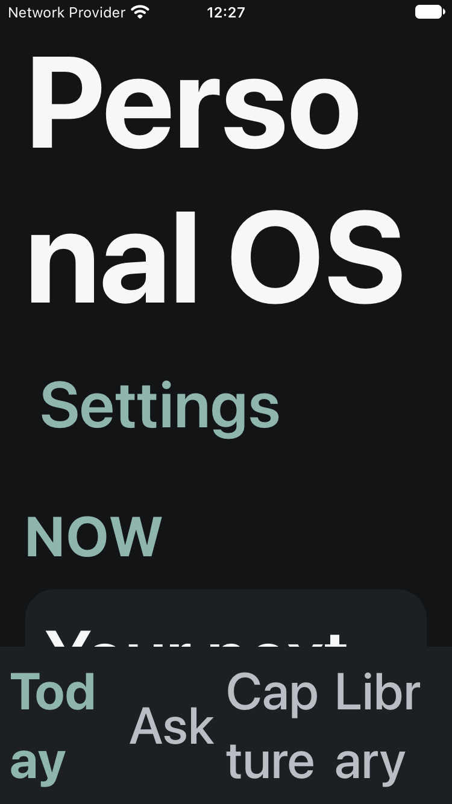
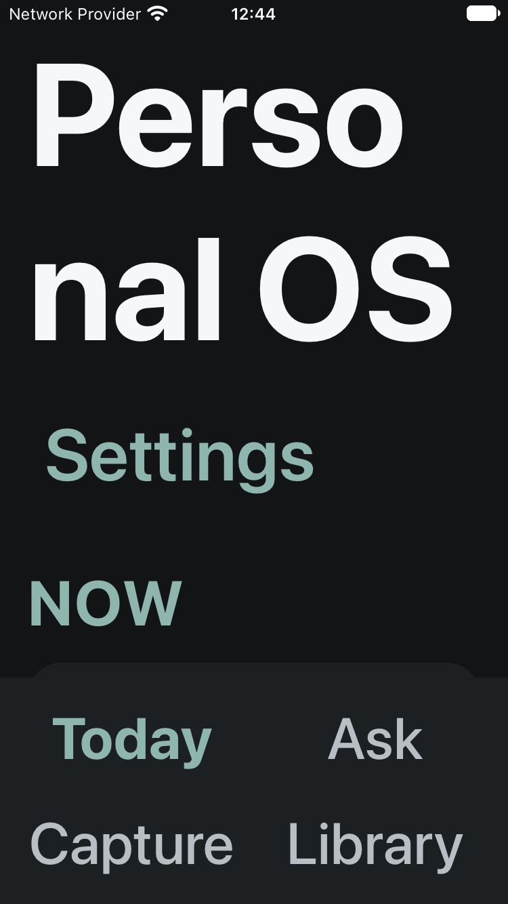
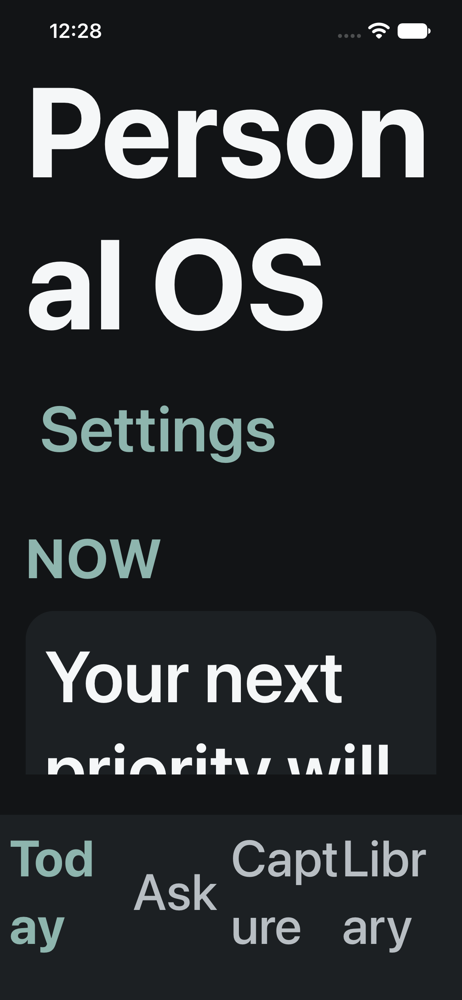
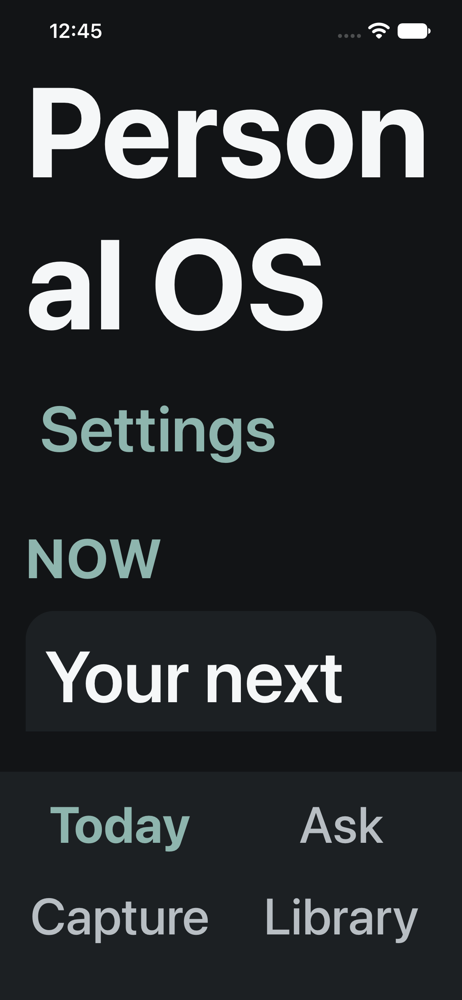

# Responsive navigation investigation — 27 October 2026

## Original investigation — historical evidence and scope

The review started from PR #3 head `a1c5577e6587c449469fb297a7c0a692294e200e`
on `feat/mvp-shell-navigation`. The separate PR worktree was clean. The main
checkout's unrelated native changes, all other worktrees, stashes and Metro were
preserved.

The existing physical test-build verification records that same source head,
bundle ID `com.briffits.personalos.pr3.voiceover`, and display name
**PersonalOS VO Test**. Its navigation source matches the baseline. No new device
build, signing change, installation or phone launch was performed in this review.
The production/v2 app and its data were not accessed.

The following reports initially blocked acceptance; the current retest and
reclassification below supersede their blocker status:

- Enlarged text with VoiceOver off: bottom navigation could not be seen/used to
  reach Ask or Capture.
- VoiceOver on: left/right swipes repeatedly produced tones or no spoken movement;
  touch exploration read app content.
- “Personal OS, heading” was spoken. This does not prove a separate Today heading
  or successful Headings rotor navigation.

The exact phone text category, Display Zoom and cause of its reported navigation
loss remain unknown. The connected model is iPhone 13 Pro. Simulator coverage
includes its standard 390 × 844-point portrait layout and 375 × 667 points;
this does not establish the phone's effective dimensions under Display Zoom.

## Reproduced defect and fix

The old bar put four flex children into a single row regardless of font scale.
At 375 points, each tab received about 90 points; at 390 points, about 93.5.
At standard XXXL (scale 1.353), all labels remained readable. At accessibility
XXXL (scale 3.571), Today, Capture and Library broke within words, with adjacent
labels crowded together. The bar grew with the wrapped text; it was not a
fixed-height clipping defect. Simulator taps still worked. Complete disappearance
of the bar and the physical VoiceOver symptoms were **not reproduced**.

The fix compares available width (after side safe areas) with a 64-point base
label budget multiplied by the current font scale. It uses four columns when
there is room and two rows of two otherwise. Labels retain their existing token,
full spelling, uncapped scaling and selected weight. Controls have horizontal and
vertical padding, a 4-point gap between rows to separate native hit frames,
a minimum 44-point width, the existing minimum height of at least
44 points, and no line limit. The navigation container does not shrink and stays
outside the screen's vertical ScrollView; its intrinsic height reserves space
above the bottom safe area. Content remains scrollable in the remaining space. On the notched simulator,
the existing screen SafeAreaView also reserves its own bottom inset, leaving an
extra gap above the bar. That existing screen layout was retained; it does not
clip the navigation.

There are no new dependencies, routes, permissions, focus overrides or shared
token changes. Today stays the launch destination. Accessibility names, button
roles and selected state are unchanged. Settings still hides the bar and returns
to Today. Medication and Prescriptions were not opened in Simulator or on device;
their existing return paths remain covered by mocked regression tests.

## VoiceOver code inspection

The shell has no explicit focus trap, accessibility-modal container, hidden
accessibility subtree or focus-setting call. Tab controls keep stable keys while
main content changes. Settings removes the tabs and remounts them on return.
Ask/Capture reuse one screen component with changed content. Native accessibility
focus after those transitions needs physical observation; no focus patch is
justified by the present evidence alone.

The Today screen's heading is **Personal OS**. Its visible **TODAY** section label
has no header role. No separate Today heading or rotor result is claimed.
Automated accessibility trees, hit testing and audits do not verify spoken iOS
VoiceOver, reading order, rotor gestures or focus restoration.

## Original physical retest plan — partially completed

The original plan below preceded installation of the updated isolated build.
It is retained as the full planned matrix, not a claim that every check is still
needed or has passed. Use the focused remaining checks below for follow-up. Do not open Medication/Prescriptions
or approve permission prompts. Record build, iOS version, appearance, Display
Zoom, system size and any per-app text-size override first.

1. With VoiceOver off, use **Settings → Accessibility → Display & Text Size →
   Larger Text**. Check default Large (fourth standard step), standard XXL
   (sixth of seven standard steps), and standard XXXL (rightmost with Larger
   Accessibility Sizes off). Enable Larger Accessibility Sizes and check its
   first extra step (Accessibility Medium), second (Accessibility Large), and
   rightmost (Accessibility XXXL). Repeat light and dark. Record the actual
   slider setting; do not infer it from how large the text looks.
2. At each setting, launch into Today; read and tap every tab; return to Today
   from Ask, Capture and Library. Open Settings and use Back to Today, including
   after scrolling. Confirm all labels and touch areas remain available without
   scrolling the navigation itself.
3. Enable VoiceOver. Touch Personal OS, then use one-finger left/right swipes;
   record exact speech, focus outline and any tones. Compare touch exploration.
   Check each selected tab's announcement and reading order through both rows.
4. Use the Headings rotor on Personal OS, Ask, Capture and Settings. Record each
   result independently. Check destination focus and repeated Settings returns;
   note whether focus remains on a tab, moves to content or becomes unreachable.
   Do not mark a separate Today heading as passed.

If tones recur, record the current element, gesture, rotor selection and whether
similar navigation works in iOS Settings. This helps distinguish an app focus
problem from an interaction/configuration issue without assuming either cause.

## Before / after screenshots

These screenshots contain only synthetic shell content, at accessibility XXXL
in dark appearance. The originals are retained at native Simulator resolution.
They show the unchanged content above the bar and the responsive navigation.

| Viewport     | Before                                                                                 | After                                                                                |
| ------------ | -------------------------------------------------------------------------------------- | ------------------------------------------------------------------------------------ |
| 375 × 667 pt |         |             |
| 390 × 844 pt |  |  |

## Final validation

The matrix uses iOS 27.0 Simulator and an Xcode 27.1 Release build with bundled
JavaScript. Each category below is exercised at both portrait viewport sizes
and in light/dark appearance. Text scale values are RN 0.87.1's mapping.

| Category                     | `simctl ui <device> content_size` value | Font scale |
| ---------------------------- | --------------------------------------- | ---------- |
| Default / Large              | `large`                                 | 1.000      |
| Standard XXL                 | `extra-extra-large`                     | 1.235      |
| Largest standard / XXXL      | `extra-extra-extra-large`               | 1.353      |
| Accessibility Medium         | `accessibility-medium`                  | 1.786      |
| Accessibility Large          | `accessibility-large`                   | 2.143      |
| Accessibility XL             | `accessibility-extra-large`             | 2.643      |
| Accessibility XXL            | `accessibility-extra-extra-large`       | 3.143      |
| Largest accessibility / XXXL | `accessibility-extra-extra-extra-large` | 3.571      |

Final matrix result: **32/32 runs passed**, with 160 captured screen states.
Visual comparison confirmed complete tab labels across all eight sizes in both
appearances on both viewports.

Every run checks fresh-launch Today, every main tab's existence, selected state,
44-point minimum dimensions, in-window bounds and non-overlapping hit frames.
It taps Ask, Capture and Library and returns from each to Today, scrolls each
main destination, checks Settings/Back to Today twice, and relaunches into Today.
Screenshots capture Today, Ask, Capture, Library and Settings. Visual review checks
complete labels, wrapping, crowding, clipping, content separation and safe areas.
No Medication/Prescriptions destination is opened.

At maximum size, the small-screen bar is about 167 points tall including its
padding; each control is about 179.5 × 73.5 points. The phone-sized bar is about
192.7 points tall including the 34-point bottom inset; each control is about
187 × 73.3 points. Both leave a scrollable content viewport. At standard sizes,
the single-row layout and existing minimum control heights are retained.

The first native two-row iteration exposed adjacent hit frames sharing a boundary
at an intermediate category on the small screen. The final version adds the
existing 4-point spacing token between rows and reruns the entire matrix.

The full Jest suite passes (13 suites, 323 tests), as do TypeScript, ESLint,
changed-file Prettier, whitespace checks and the Release Simulator build.
Jest additionally retains the existing mocked Medication/Prescriptions route
regression coverage; this is not a real-data or physical-device check.

Supplementary default/maximum XCTest audits cover contrast, element detection,
hit regions, descriptions, traits and clipped text. Audit result: **40/40 captured-state audits reported no findings**.
They supplement screenshots and taps; they do not establish VoiceOver speech.

These automated results remain valid and were not repeated for the documentation
update. Physical evidence and its remaining limits are reconciled below.

## User-confirmed physical retest — 27 October 2026

Source: `f30454c770021a7c48f423e233af1376b8a08d86`; iPhone 13 Pro;
**PersonalOS VO Test** (`com.briffits.personalos.pr3.voiceover`). The isolated
Release app was built with bundled JavaScript, verified, installed and launched.
Its signed Keychain entitlement is private to the test identity; the provisioning
profile's broader wildcard allowance is not present in the app's signed
entitlements. No app-group, iCloud or HealthKit entitlement is signed into it.
Build/install records remain outside the repository. The production/v2 app and
its data were preserved. This update records user observations, not agent-run
manual checks. Display Zoom and per-app text overrides were not captured.

### VoiceOver off

| Text setting                 | Appearance     | User-confirmed result                                                                       |
| ---------------------------- | -------------- | ------------------------------------------------------------------------------------------- |
| Largest standard / XXXL      | Light and dark | All four tabs readable and usable; destinations and Settings → Today worked.                |
| Accessibility Medium         | Dark           | Tabs usable; no additional route/focus pass inferred.                                       |
| Accessibility Large          | Dark           | Tabs usable; no additional route/focus pass inferred.                                       |
| Largest accessibility / XXXL | Dark           | Navigation and Settings → Today worked.                                                     |
| Largest accessibility / XXXL | Light          | All four tabs readable and tappable; no Settings-return pass inferred for this combination. |

### VoiceOver on — largest accessibility text, light appearance

- “Personal OS, heading” was announced. This is the Today screen heading, not
  evidence of a separate TODAY section heading or a rotor pass.
- Short one-finger flicks traversed content and reached tabs. Exact traversal
  order was not reliably established.
- The user identified earlier long swipes as the likely reason for tones/no
  movement. This is a likely gesture explanation, not a proven root cause;
  the earlier observations alone are not a confirmed app defect.
- Library activated and announced selected. The user reported focus moving into
  Library, but the precise destination target was not captured.
- Returning to Today announced “Selected, Today tab”; an exact focus target is
  not inferred from that announcement alone.
- Settings opened with “Settings, heading” and its placeholder content was read.
  The user reported no tones or focus loss at that point.
- VoiceOver was subsequently turned off. Settings → Back to Today with VoiceOver
  was not confirmed in this retest.

### Reconciliation with earlier evidence

The retained local `manual-voiceover-observations.md` from the earlier isolated
device build corresponds to `a1c5577e6587c449469fb297a7c0a692294e200e`.
Its text size and appearance were unspecified. It records:

- Ask activation with focus on its top heading, “Selected Ask Tab Button”, and
  Headings rotor navigation announcing “Ask Heading”.
- Capture activation with “Selected Capture Tab” and focus remaining on the tab;
  rotor navigation then announced “Capture Heading”. Placeholder content was
  read completely and traversal reached Today. This is a limited recorded order,
  not proof of the entire shell traversal order.
- Capture → Today announced “Selected Today Tab” with focus on the bottom tab.
- Settings initially focused Back to Today; the rotor reached “Settings heading”.
  Back to Today announced “Selected Today tab” and focused that bottom tab.

These are genuine historical passes, not unverified checks to erase or passes
for the new build at maximum text. Between the two commits, application code
changes are confined to BottomNavigation layout; heading and route logic are
unchanged. Historical rotor/content evidence remains relevant, while native
focus and traversal through the new two-row layout need their own observations.
The new Settings heading announcement does not establish its precise initial
focus location. No complete physical scrolling check is recorded in either
session. Simulator scrolling/layout evidence cannot establish VoiceOver behavior.

### Review readiness and focused remaining validation

**Ready for final review, with limited physical accessibility validation still
open; keep PR #3 draft.** The reported navigation-usability blocker is resolved
for the user-confirmed settings above. No current app defect is demonstrated by
the swipe-tone report: short flicks now work and no tones/focus loss were reported
in the latest pass. The original phone configuration/cause is not reconstructed,
and the full planned physical matrix is not complete.

Before claiming complete current-build VoiceOver navigation acceptance, perform
one focused pass at largest accessibility text in light appearance:

1. From Settings, activate Back to Today with VoiceOver and record the spoken
   result and actual focus target. Confirm navigation remains reachable after
   the tabs remount. This closes the current-build return-focus evidence gap;
   the earlier unspecified-configuration return already passed.
2. Record traversal through both tab rows using short flicks, without skipped or
   unreachable controls. Activate Ask and Capture and record destination focus
   and selected announcements. Include reaching content after any required
   vertical scroll. Exact Library focus can be recorded in this same pass if
   needed; the latest session already confirmed its activation and selection.

These are targeted validation gaps, not confirmed defects or a request to rerun
all tests. Remaining rotor checks (including Personal OS, never yet confirmed),
full scrolling coverage, exact whole-screen traversal order and untested physical
size/appearance combinations remain explicitly incomplete. Historical Ask,
Capture and Settings rotor passes need not be repeated merely to resolve the
reported blockers. No broad matrix rerun or code change is justified without a
new failure. Medication/Prescriptions and permission requests remain excluded.
